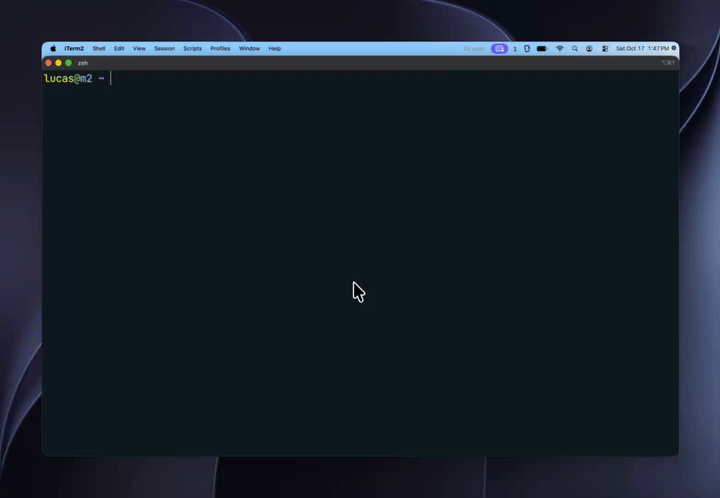

# Vix



Vix is the fast, vim-inspired visual terminal multiplexer you never knew you needed.

To understand how to maneuver using vix, type `vix --keys` in the terminal, or type :h in command mode
when inside vix.

## Installation

### Homebrew (macOS, Linuxbrew)

```sh
brew tap justamapping/tap
brew install vix
```

### Prebuilt binary (macOS, Linux)

```sh
curl --proto '=https' --tlsv1.2 -LsSf https://github.com/justamapping/vix/releases/latest/download/vix-installer.sh | sh
```

### Using Cargo

To install vix, clone this repository, and type `cargo install --path . --locked`, then type `vix`, and you're in!

## States

There are a two primary states inside of vix to know:

1. List mode (normal or insert mode), this is for creating new terminal windows via a vim-based text editor.
Hitting enter will go into view mode inside of the terminal you select


2. View mode (normal or terminal mode), this is for viewing your terminal windows. Normal mode allows you to
navigate, scroll, and manipulate text inside your terminal. Terminal mode allows you to use your regular
terminal without any interference until you hit your escape sequence to get back into normal mode.


## Configuration

You can configure vix inside of `~/.config/vix/config.toml`
An example config to get started is inside of [Examples](./examples/config/config.toml)

## How to exit vix
`:q!<Enter>` or, you can ask your agent to help you quit vix via ctl.
