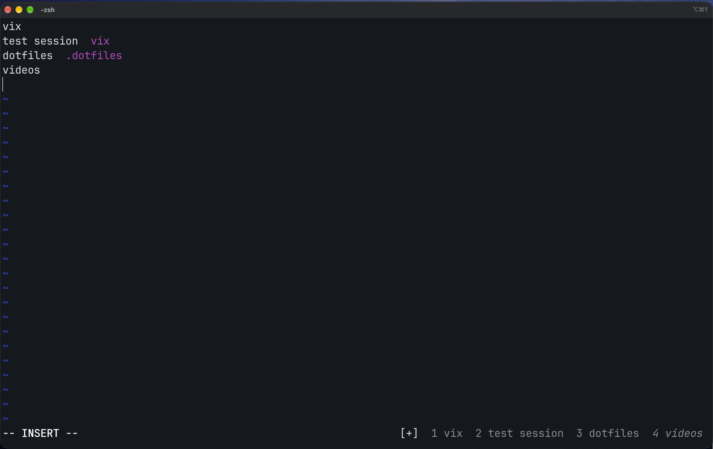
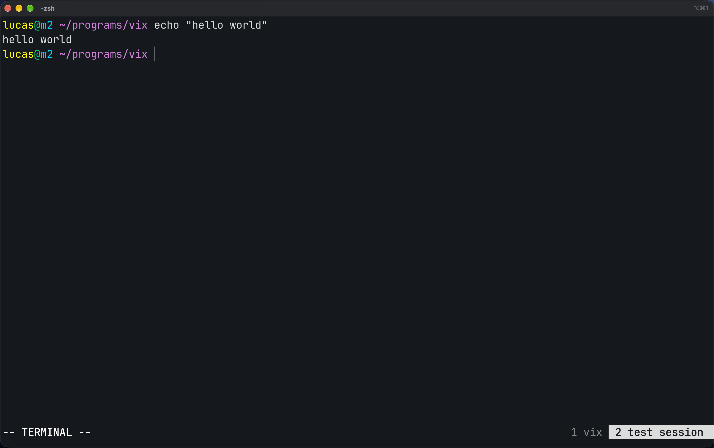

# Vix

gif of vix demo here

Vix is the fast, vim-inspired terminal multiplexer you never knew you needed. Based on vim keybinds,
you can enter a new terminal session by typing the command `vix`. It will take you to a list
of your terminals that you can name by using a vim-like editor, then go into by hitting Enter.

To understand how to maneuver using vix, type `vix --keys` in the terminal, or type :h in command mode
when inside vix.

There are a two primary states inside of vix to know

1. List mode (normal or insert mode), this is for creating new terminal windows via a vim-based text editor.
Hitting enter will go into view mode inside of the terminal you select

2. View mode (normal or terminal mode), this is for viewing your terminal windows. Normal mode allows you to
navigate, scroll, and manipulate text inside your terminal. Terminal mode allows you to use your regular
terminal without any interference until you hit your escape sequence to get back into normal mode.

## Configuration
